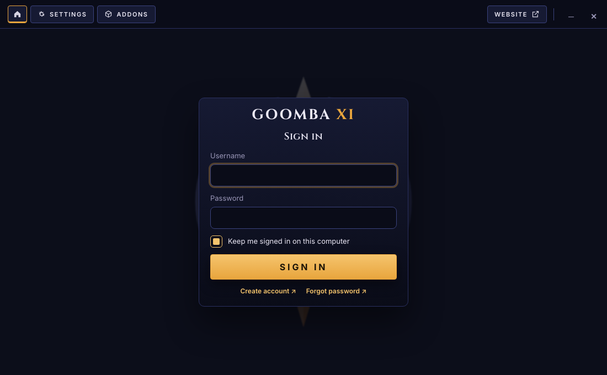

# Goomba XI — launcher

The launcher for the **Goomba XI** FINAL FANTASY XI server, for **Windows** and **Linux** (including the Steam Deck). Electron + React, the same launcher as Bahamut XI with the Goomba XI name and look.



- **Ships the whole game.** Players install the launcher and press **Install**: FFXI, PlayOnline, Ashita v4 and Phoenix's xiloader land in one folder and run through Ashita's Sandbox plugin. No retail install, no registry entries, no admin rights.
- **Era-accurate client.** The Phoenix [Era-DATs](https://github.com/phoenixffxi/Era-DATs) ship inside the client as an always-on XIPivot overlay, so shops, prices, menus and dialogue match the Level 75 server.
- **Signs in through the website.** Players use their Goomba XI website account; the launcher shows their characters and, on **Play**, gets a single-use *launch token* that xiloader sends instead of the password. The launcher never stores the password.
- **Linux runs on GE-Proton by default.** The launcher downloads the pinned GE-Proton build (GE-Proton11-5, the same one Phoenix ships) and umu-launcher, prepares a Wine prefix with the components the game needs, and starts the game. Players don't install Wine or Proton themselves.
- **Patches from your file server**: compressed, content-addressed, SHA-256 verified, resumable, with Verify & Repair.
- **Approved addons only.** The client build removes every Ashita addon and plugin that isn't on the server's approved list; players can install more approved ones from the file server catalog, and HD texture/map/UI packs from the **Pivot** tab.
- **Settings** for game, graphics, Linux runtime, controller (with a live diagram) and misc (verify files, logs, screenshots, **Add to Steam Library**).

## How it fits together

```
 website (game server VM)        player's PC                game server VM / file server LXC
 ────────────────────────        ───────────               ──────────────────────────────────
 /api/launcher/login   ◄─sign in─  launcher ──Play──► xiloader ──launch token──► login server
 /api/launcher/me      ◄─chars──┘     │                                           (LandSandBoat + patch)
 /api/launcher/launch-token ◄──Play──┘
                                      └──downloads──► launcher/client/manifest.json + files/
                                                      launcher/addons.json, pivot.json, news.json
                                                      launcher/GoombaXI-Setup.exe, GoombaXI.AppImage
```

## 1. Configuration

`launcher.config.json` is bundled into the installer. Point it at your servers with one command (it rewrites every URL below):

```bash
node tools/configure.mjs --server 10.2.5.64 --files http://10.2.5.65
node tools/configure.mjs --show          # what it points at now
```

With a domain later: `--server goomba-xi.example --website https://goomba-xi.example --files https://files.goomba-xi.example`. The important keys:

| Key | Value / meaning |
| --- | --- |
| `serverName`, `serverId` | `Goomba XI`, `goomba` (names the Ashita boot profile). |
| `serverHost` | Hostname of the game server (login server). |
| `websiteUrl` | `http://10.2.5.64` on a home network. Turns on website sign-in, the character list and launch tokens. Leave empty to sign in directly against the login server instead. |
| `registerUrl`, `accountUrl` | Website pages for **Create account** and the account button. |
| `manifestUrl`, `newsUrl`, `addonCatalogUrl`, `pivotCatalogUrl` | Files on the file server (see section 4). |
| `requiredOverlays` | `["era"]`: the Era-DATs overlay folder shipped in the client, always on and loaded before cosmetic packs. |
| `requiredPlugins`, `defaultPlugins`, `requiredAddons`, `defaultAddons` | Addon policy. `winefix` is added to the defaults automatically on Linux. |
| `linux.protonVersion` | `GE-Proton11-5`. Empty = always the latest GE-Proton. `linux.protonUrl` / `linux.umuUrl` let you serve those downloads from your file server. |
| `links` | Buttons in the top bar (Website, Discord…). |
| `theme` | `goomba` (also `slate`, `blue`). |

Other keys (ports, hairpin, script binds and commands, `verifyLogin`, `allowAccountCreation`) are described in `src/shared/types.ts`.

## 2. Build the client (once per game update)

A beginner-friendly walkthrough of steps 2 and 3, with every command for a Windows PC, is in the server repository: [docs/client-and-launcher.md](https://github.com/ricardo-monreal/goomba-xi-server/blob/main/docs/client-and-launcher.md).

On a Windows PC (or any machine with the files copied over):

1. **A clean, fully patched retail install.** Install FFXI from Square Enix, update it with PlayOnline's *Check Files*, and never log into a real account with it. The server's `CLIENT_VER` (`/opt/goomba/server/settings/default/login.lua` on the game server) must match.
2. **Ashita v4:** `git clone https://github.com/AshitaXI/Ashita-v4beta vendor/Ashita-v4beta` (commit `4171c74` is the one this launcher was tested with).
3. **Phoenix xiloader:** run the **xiloader** workflow in this repository's Actions tab (it builds `phoenixffxi/xiloader` as 32-bit) and save the artifact as `vendor/xiloader.exe`. The upstream LandSandBoat xiloader does **not** send launch tokens; the Goomba XI server accepts the Phoenix one through `goomba-xi-server/patches/0001-launch-token-login.patch`.
4. **Era-DATs:** `git clone https://github.com/phoenixffxi/Era-DATs vendor/Era-DATs`.
5. **XIPivot:** download the Ashita v4 build from https://github.com/HealsCodes/XIPivot/releases and put `pivot.dll` in `overlay/Ashita/polplugins/`.

```bash
node tools/build-client.mjs \
  --ffxi     "C:/Program Files (x86)/PlayOnline/SquareEnix/FINAL FANTASY XI" \
  --pol      "C:/Program Files (x86)/PlayOnline/SquareEnix/PlayOnlineViewer" \
  --ashita   ./vendor/Ashita-v4beta \
  --xiloader ./vendor/xiloader.exe \
  --era      ./vendor/Era-DATs \
  --overlay  ./overlay \
  --out      ./client

node tools/make-manifest.mjs ./client ./publish --gzip --version 2026.10.22-1
```

`build-client`:
- copies Ashita, xiloader, the game and PlayOnline into `client/`, leaving out personal data (FFXI `USER/`, POL `usr/` and its key file, Ashita boot profiles, addon settings);
- copies the Era-DATs `ROM*` folders to `Ashita/polplugins/DATs/era/`;
- **removes every addon, plugin and pol-plugin not on `client-config/approved-addons.json`** (Ashita bundles automation and packet tools the rules forbid, e.g. `autojoin`, `repeater`, `skeletonkey`). `addons`, `thirdparty`, `winefix`, `sandbox` and `pivot` are always kept. The removed list is printed and saved in `client/client.json`.

`client-config/approved-addons.json` is a copy of the website's list (`goomba-xi-web/src/data/approved-addons.json`); copy it over when the list changes.

`make-manifest` writes `publish/manifest.json` plus gzip blobs. Upload `publish/` to the file server as `launcher/client/` (blobs first, `manifest.json` last). Re-running with the same `publish` folder only adds changed files.

## 3. Build and publish the launcher

Push a tag like `v1.0.0`: the **release** workflow builds `GoombaXI-Setup-<version>.exe` (Windows, NSIS) and `GoombaXI-<version>-x86_64.AppImage` (Linux) and attaches them to a GitHub release. Then copy them to the file server under fixed names so the website's download buttons always get the latest:

```
launcher/GoombaXI-Setup.exe
launcher/GoombaXI.AppImage
```

Local builds: `npm run dist` (Windows) and `npm run dist:linux` (Linux).

## 4. File server layout

The file server is a separate machine (any static host: nginx, S3/R2 + CDN). On Goomba XI that is the Debian 13 LXC set up by `goomba-xi-server/tools/setup-file-server.sh`. Everything lives under `http://<file server>/launcher/` (on disk: `/srv/goomba/files/launcher/`):

```
launcher/
  GoombaXI-Setup.exe          latest Windows launcher
  GoombaXI.AppImage           latest Linux launcher
  news.json                    launcher news (file-server/news.json)
  client/manifest.json         game client manifest (from make-manifest)
  client/files/ab/abcdef….gz   game client blobs
  addons.json                  optional addons/plugins catalog
  addons/*.zip
  pivot.json                   optional HD packs catalog
  packs/*.zip
icons/items/<id>.png           item icons for the website (goomba-xi-web scripts/import-items.mjs)
```

Catalogs: list addons and packs in `file-server/catalog-sources.json`, put the zips in `addons/` and `packs/`, then:

```bash
node tools/make-catalogs.mjs --files /srv/goomba/files/launcher --base-url http://10.2.5.65/launcher
```

It fills in size and SHA-256 for every zip, skips missing ones, and refuses addons that aren't approved. Only host packs and addons whose licence allows it, and credit their authors with `author` and `links`.

Pack zips contain `ROM/`, `ROM2/` … folders mirroring the game's; packs in the same `category` are mutually exclusive. Addon zips use the Ashita layout (`addons/<name>/<name>.lua`, `plugins/<name>.dll`) or just the addon folder / DLL.

## Linux and Steam Deck

On first **Play** (or **Settings → Linux → Set up now**) the launcher:
1. downloads GE-Proton11-5 (SHA-512 verified) and umu-launcher into `~/.local/share/Goomba XI/runtimes/`;
2. creates a Wine prefix in `<install folder>/wineprefix` and installs **Visual C++ 2015-2022**, **GDI+** and Windows 10 mode (optionally **all fonts**) through winetricks;
3. starts Ashita with paths converted to `Z:\…`.

**Settings → Linux** offers the runtime (GE-Proton official, any Wine/Proton found on the PC, or a custom one), Proton/umu logging, game environment variables (`DXVK_HUD=fps`, `MANGOHUD=1`), prefix components, and **Recreate Linux environment**.

Players need `python3` (for umu; present on almost every distribution and the Deck) and FUSE 2 for the AppImage (`sudo apt install libfuse2t64` on Ubuntu 24.04+).

**Steam Deck:** in Desktop Mode, make the AppImage executable and open it, install, sign in and press Play once. Then **Settings → Misc → Add to Steam Library** (with Steam closed) and return to Game Mode. Don't force a compatibility tool on the shortcut: the AppImage is a Linux program and brings its own Proton.

## How a launch works

1. The launcher checks the manifest and offers an update if anything changed.
2. On **Play** it prepares Proton on Linux, then asks the website for a launch token at the last moment (tokens expire after 5 minutes).
3. It writes `Ashita/config/boot/goomba.ini` (xiloader as the boot file, `--json` pointing at a temporary file holding the username and `login_token`, the player's game settings and the Sandbox paths), the XIPivot config with `era` first, and `Ashita/scripts/goomba.txt` loading the enabled plugins and addons.
4. It runs `ashita-cli.exe goomba.ini` (elevated on Windows, through umu/Proton on Linux). The temporary file is deleted a minute later.

## Develop

```bash
npm install
npm run dev          # hot-reload window
npm run typecheck
```

## Project layout

```
launcher.config.json         server settings (bundled into the installer)
client-config/               approved addons list used by the client build and catalogs
file-server/                 news.json and catalog-sources.json for the file server
resources/                   app icons
src/main/                    Electron main process
  website.ts                 website launcher API (sign-in, characters, launch tokens)
  launch.ts                  credential/launch-token handoff to xiloader, Ashita start
  wine.ts                    GE-Proton/umu runtime and Wine prefix (Linux)
  steam.ts                   Add to Steam Library (shortcuts.vdf)
  patcher.ts, pivot.ts, catalog.ts, ashita.ts, config.ts, credentials.ts
src/renderer/                React UI (top bar, home, sign-in, settings, addons, pivot)
tools/                       build-client, make-manifest, make-catalogs
.github/workflows/           ci, release (installers), xiloader (Phoenix build)
```

## Caveats

- **Test on clean machines before release:** a fresh Windows VM, an Ubuntu desktop and a Steam Deck. Try an install folder with spaces in it.
- **Antivirus** can slow the first install and sometimes flags Ashita's injector; code-signing the Windows launcher helps.
- **Launcher self-update** isn't included; players download new launcher versions from the website. Game files update automatically.
- The FINAL FANTASY XI and PlayOnline files are Square Enix's copyrighted software. Redistributing them is what private servers do, but it is your decision and your risk.
